<div align="center">


<h3>The organisers' side of TRSYP 3.0</h3>

<p>
  Payment review, participants, IEEE membership checks, teams and rooms,<br>
  for the committee of the IEEE Tunisian RAS Student &amp; Young Professional Congress.
</p>

<p>
  
  
  
  
  
  
</p>

<p>
  <a href="https://github.com/IEEE-INSAT/TRSYP3.0"><b>Main platform</b></a> ·
  <a href="#-how-it-works"><b>How it works</b></a> ·
  <a href="#-payment-review"><b>Payment review</b></a> ·
  <a href="#-architecture"><b>Architecture</b></a> ·
  <a href="#-getting-started"><b>Getting started</b></a>
</p>

</div>

<br>

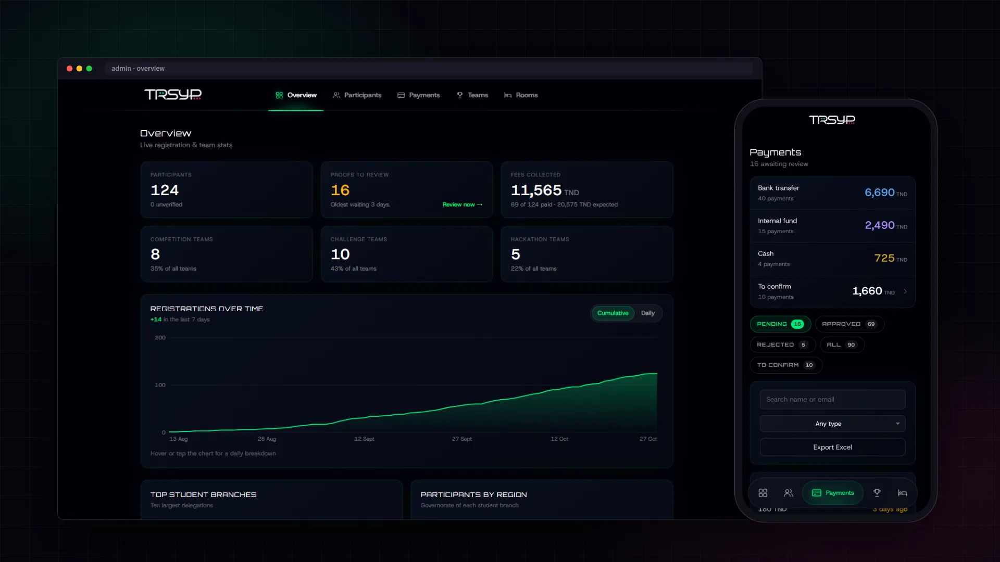

## Contents

- [About](#-about)
- [Features](#-features)
- [A quick tour](#-a-quick-tour)
- [How it works](#-how-it-works): where the data comes from, who may enter, what each side writes
- [Payment review](#-payment-review): the queue, the rules and the review flow
- [IEEE membership checks](#-ieee-membership-checks)
- [Architecture](#-architecture) · [Getting started](#-getting-started) · [Engineering notes](#-engineering-notes)

## 📌 About

**TRSYP 3.0** took place on **16 to 18 October 2026** at Le Royal, Yasmine Hammamet. Participants signed up, formed
teams, paid and picked their rooms on the [main platform](https://github.com/IEEE-INSAT/TRSYP3.0). This portal is the
other side of it: the committee used it to check payment receipts, follow registrations, verify IEEE memberships
and export lists for the venue.

It is a separate Next.js app that reads the **same database** as the main platform. Anything with side effects on a
participant's payment goes through the main platform's API, so both apps always apply the same rules.

<div align="center">

| **5** | **1** | **70** |
|:---:|:---:|:---:|
| admin screens | shared database | commits |

</div>

## ✨ Features

| | Feature | What it does |
|---|---|---|
| 📊 | **Overview** | Live counts, fees collected against fees expected, registrations over time, top student branches, a map by governorate, membership, payment status and gender split. |
| 👥 | **Participants** | Search across name, email, phone, IEEE number, branch and team. Filter by payment, membership, branch, activity and rooming. Open anyone's full record. |
| 💳 | **Payment review** | A queue of receipts with approve, reject with a reason, cash payments, and the treasurer's record of how each payment arrived. |
| 🪪 | **IEEE checks** | Shows what IEEE's records say about each participant, and re-checks anyone on demand against IEEE's member API. |
| 🏆 | **Teams** | Every team of the Competition, the Technical Challenge and the Fablab hackathon, with each member's payment state and the hackathon's concept submissions. |
| 🛏 | **Rooms** | Every double room, who shares it and which ones still wait for a roommate. |
| 📤 | **Excel exports** | Participants, payments, teams and rooms, as `.xlsx`, filtered the way they are on screen. |

## 📸 A quick tour

> Captured from the running portal on sample data: participants appear as "Participant 1", "Participant 2"… with
> `example.com` emails and placeholder phone numbers.

### Overview

Where registration and payments stand at a glance, with the proofs waiting for review one click away.

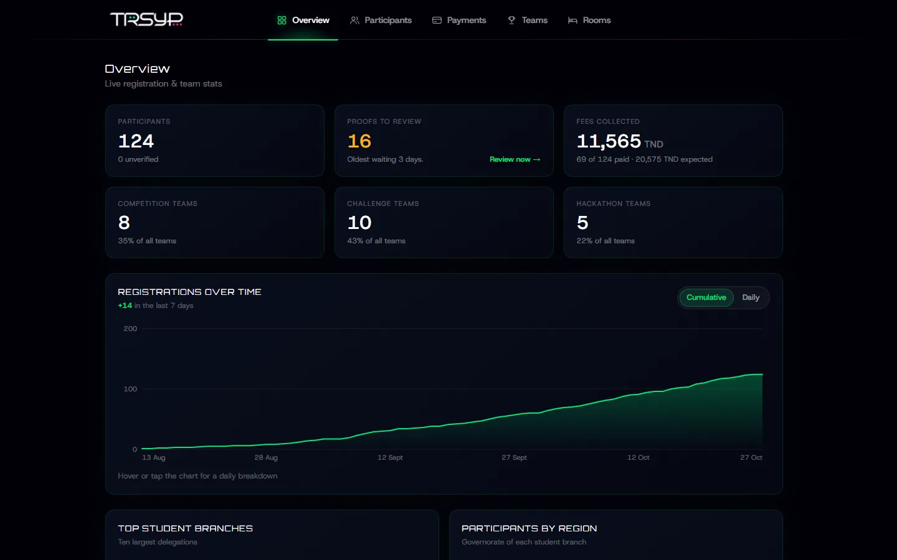

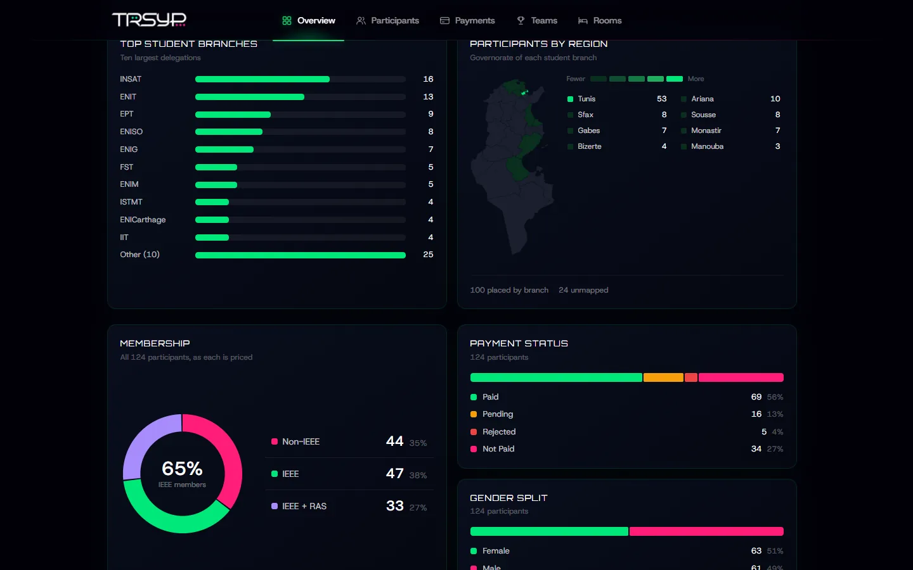

### Participants

One searchable list, filters kept in the URL so a filtered view can be shared or refreshed.

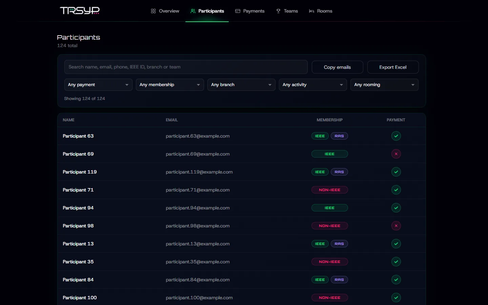

### A participant's record

Avatar, payment, profile, roommate, teams and IEEE's answer, with a button to check IEEE again.

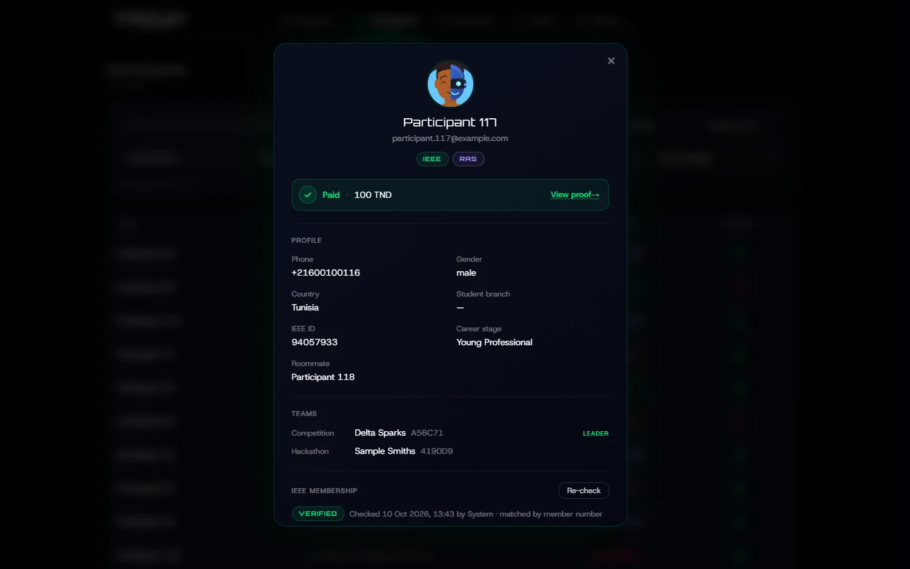

### Payments

Money in by how it arrived, the review queue by status, and approve or reject on each row.

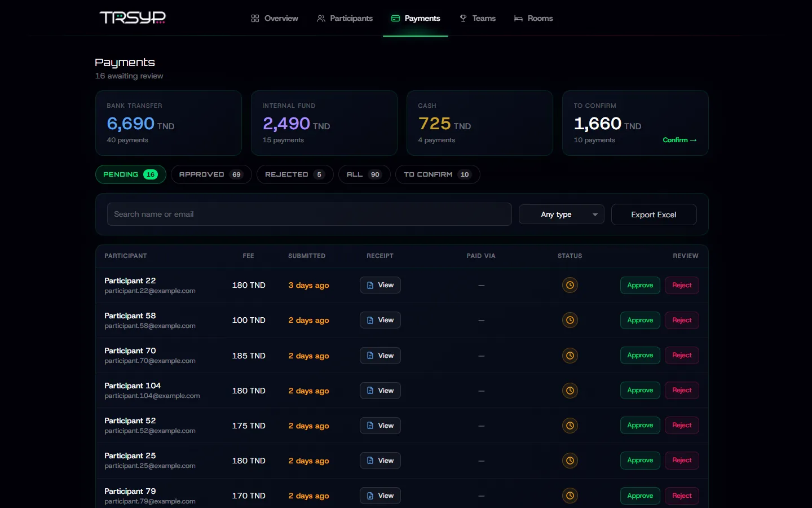

### Teams

Each team with its code, how many members have paid, and every member's payment state.

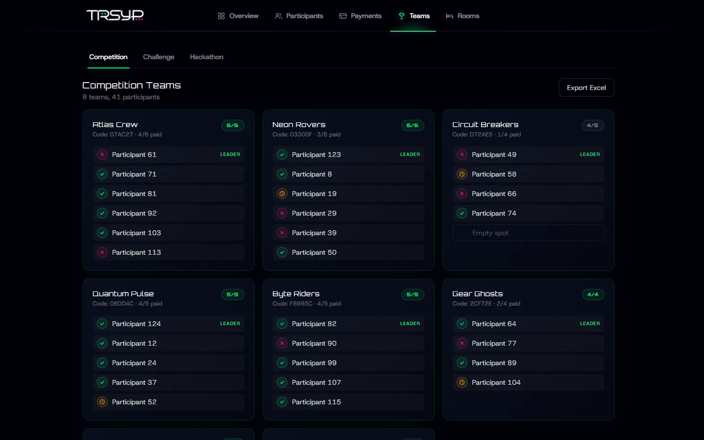

The Fablab hackathon groups teams by axis and shows whether each one submitted its concept.

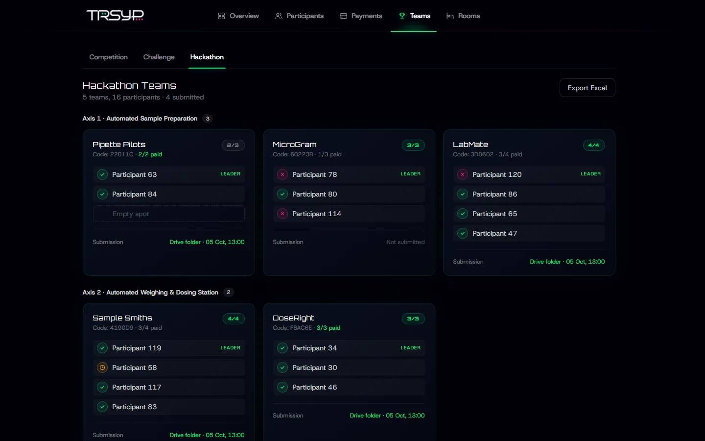

### Rooms

Full rooms, rooms waiting for a roommate, and an Excel export with each room coloured by gender.

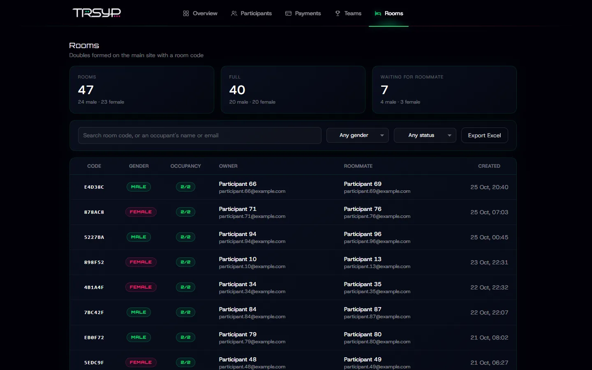

### On a phone

<p align="center">
  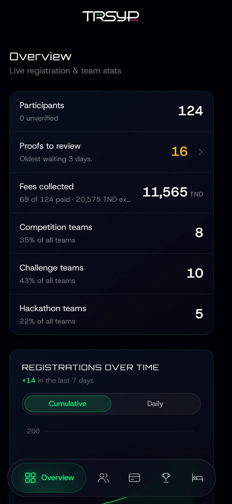
  &nbsp;&nbsp;
  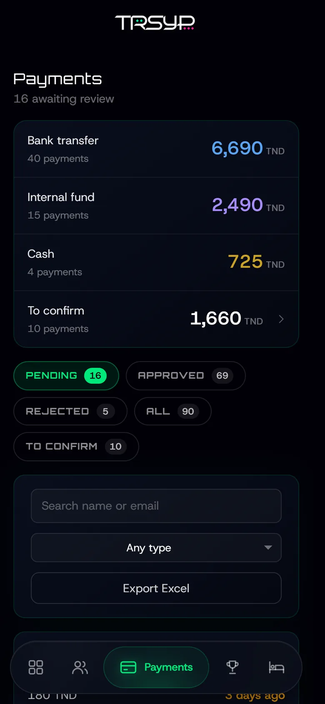
  &nbsp;&nbsp;
  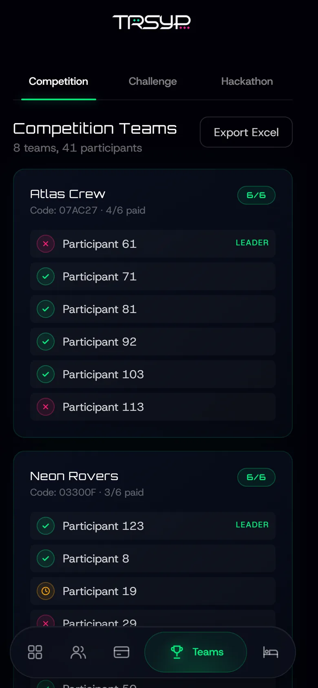
</p>

## 🧭 How it works

### Where the data comes from

The portal talks to three things, and the split is deliberate.

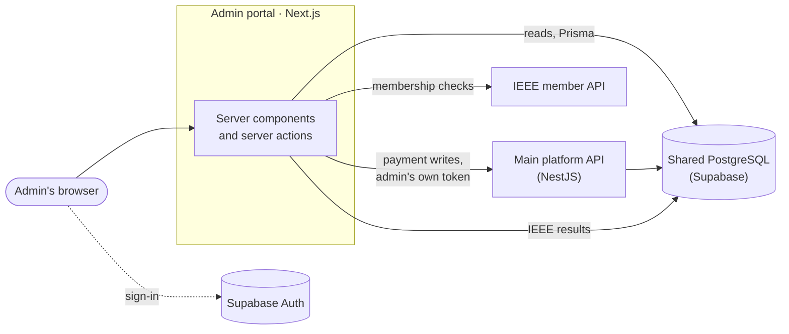

- **Reads go straight to the database** through Prisma. Lists, counts and charts are just queries, and the main
  platform's API doesn't return the nested data these pages need (teams, room, IEEE check, avatar).
- **Payment writes go through the main platform's API.** Approving a receipt has to run the same guards as the main
  platform (a banned participant cannot be marked paid, nobody can be paid twice) and emit the same event. Those rules
  live in the API, so the portal calls it with the admin's own Supabase token instead of writing `paid` itself.
- **IEEE checks call IEEE directly** and write the result to the database, using the same rules as the main platform.

All of this runs on the server. The browser never receives a database URL, a service key or the IEEE secret.

### Who may enter

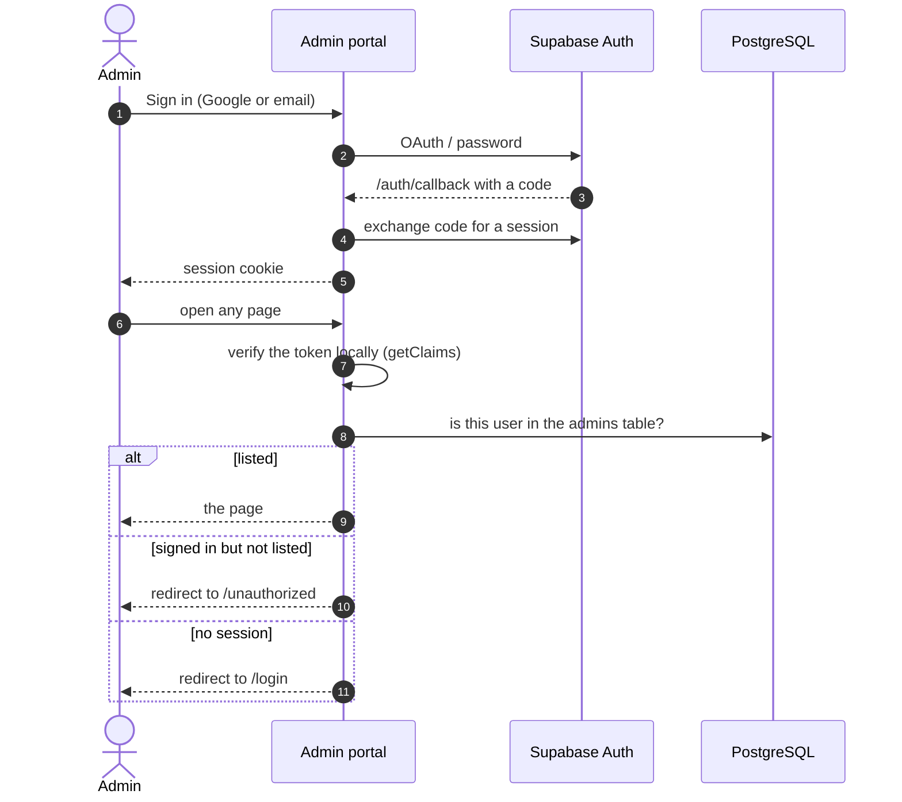

- **Being signed in is not enough.** Only users listed in the `admins` table get in. The main platform's API checks the
  same table, so the two cannot disagree about who is an admin.
- **Tokens are verified locally.** `getClaims` checks the token's signature with Supabase's public keys instead of
  calling the Auth server on every request.
- **Middleware only refreshes the session.** The admin check needs Prisma, which cannot run on the Edge runtime, so
  every protected layout calls `requireAdmin()` before rendering.
- **Server actions check again.** They can be reached by a direct POST, so each one checks the caller itself instead
  of relying on the page that shows the button.

### What each side writes

Both apps share one database. This is who is allowed to change what:

| Table | Admin portal | Main platform |
|---|---|---|
| `participants`, `users` | Reads. Writes `participant_type` and `is_ras` after an IEEE check | Owns |
| `ieee_verifications` | Reads and writes (re-checks) | Reads and writes (automatic checks) |
| `payment_proofs`, `participants.paid` | Through the main platform's API only | Owns |
| `teams`, `team_memberships`, `rooms` | Reads | Owns |
| `admins` | Reads, to let admins in | Reads, to authorise admin routes |

The full data model is described in the [main platform's README](https://github.com/IEEE-INSAT/TRSYP3.0#-domain-model).

### Fast pages with a slow dependency

The main platform ran on a free Render instance that could take a while to wake up. So every page waits only for the
database, which is fast, and everything that needs the payments API (payment icons, money tiles, the queue size)
streams in behind its own placeholder with React `Suspense`. A cold API delays a few icons, not the page.

## 💳 Payment review

### The queue

A participant can send several receipts: after a rejection, they send a new one. The queue shows **one row per
participant, their newest proof**, so an old rejected receipt never sits next to the one that replaced it.

| Tab | Shows |
|---|---|
| **Pending** | Receipts waiting for a decision, oldest first |
| **Approved** | Settled payments |
| **Rejected** | Turned down, with the reason the participant was given |
| **All** | Everyone who ever sent something |
| **To confirm** | Approved payments whose arrival the treasurer has not confirmed yet |

The tiles above the queue total the money **by how it actually arrived** (bank transfer, internal fund, cash). Fees
are priced the portal's way: a per-participant override wins, and Fablab members pay the flat 100 TND. The search
and type filter live in the URL, so a link to "pending bank transfers matching *ben*" works.

### A payment's life, from the treasurer's side

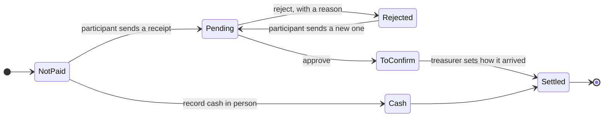

- **Approve** cannot be undone: the main platform has no "unapprove" route on purpose, so the portal asks for
  confirmation first.
- **Reject** needs a reason of 5 to 500 characters. The participant reads it word for word on their dashboard.
- **Cash** is recorded from the participant's record. It is refused if they are banned, already paid, or have a
  receipt waiting in the queue.
- **How it arrived** (bank transfer, internal fund or cash) can be changed later. Until it is set, the payment sits in
  *To confirm*.

### Reviewing a receipt

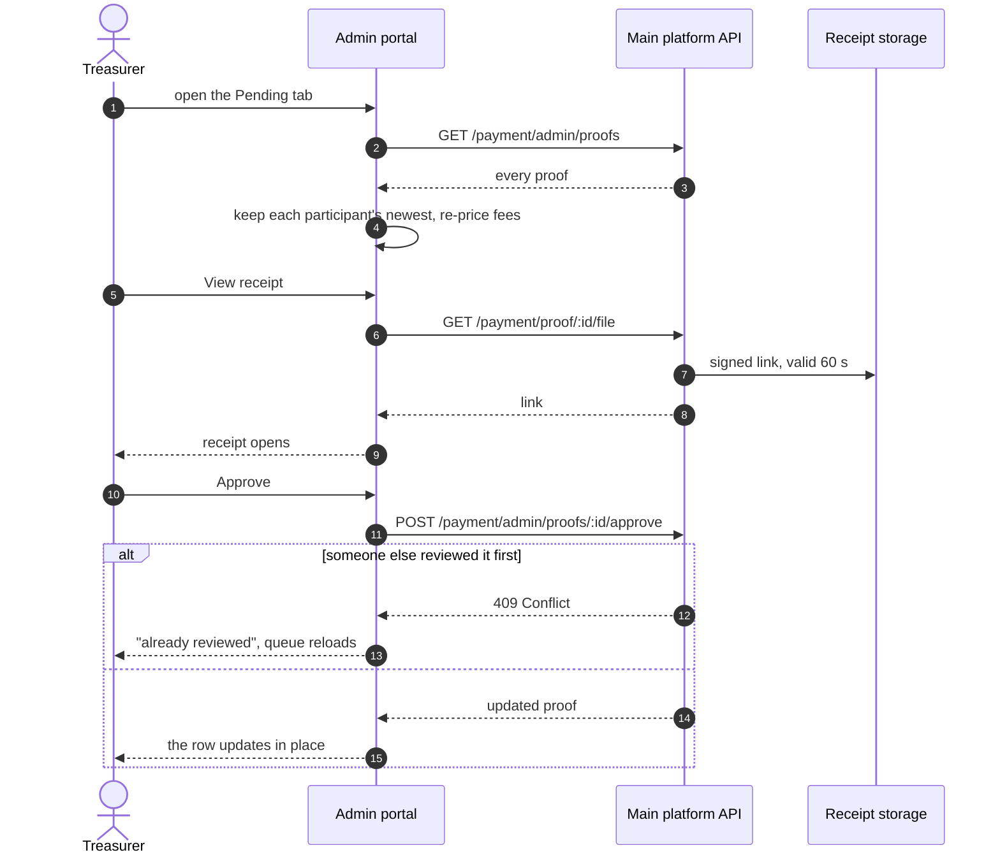

- Receipt links expire after 60 seconds, so they are requested when a receipt is opened, never in advance.
- When two admins act on the same receipt, the second gets a clear message and a fresh queue instead of an error.
- A review updates its own row in place; the rest of the queue is not reloaded.

## 🪪 IEEE membership checks

The main platform checks every new participant against IEEE automatically. The portal shows the result and lets an
admin check someone again, for example after they renewed their membership.

What a participant's badge says is worked out from IEEE's stored answer each time the page renders:

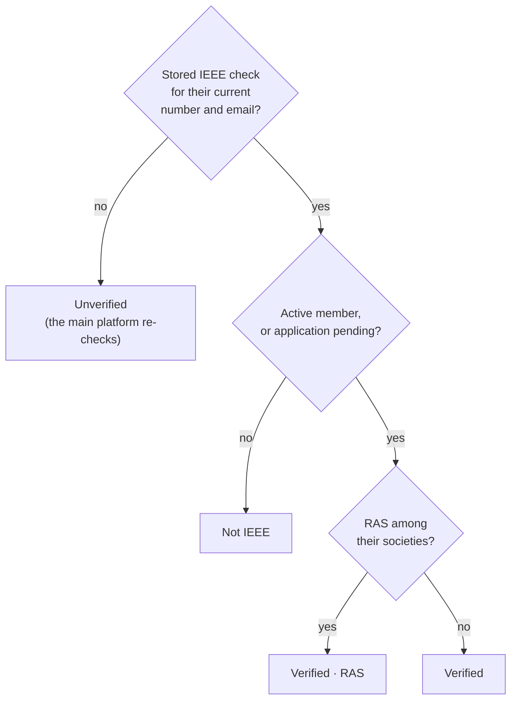

- **Lookup.** The member number first; the account email only if the participant has verified it, because the record
  found now sets their price.
- **Write-through.** A re-check stores IEEE's answer *and* updates the participant's membership and RAS flag in one
  transaction, so their fee is right immediately.
- **Out of date.** A check stops applying when the participant changes their number or email. It then shows as
  unverified until the next automatic check.
- **Safe to expose.** The browser only sends participant ids, at most 10 per request. Everything the check relies on
  is read on the server.
- **IEEE's API is slow.** The OAuth token is cached for its lifetime and shared by concurrent lookups, and each call
  allows up to 45 seconds, since IEEE has been seen taking almost 30 for a single lookup.

## 🏗 Architecture

### Tech stack

| Layer | Tools |
|---|---|
| App | Next.js 16 (App Router, server components, server actions), React 19, TypeScript |
| Styling | Tailwind CSS 4 and hand-written CSS; charts are plain SVG, no chart library |
| Data | Prisma 7 with the `pg` adapter, on the main platform's Supabase PostgreSQL |
| Auth | Supabase Auth through `@supabase/ssr` (Google and email/password), checked against the `admins` table |
| Integrations | Main platform's NestJS API (payment writes), IEEE GetMemberStatus API (membership) |
| Exports | ExcelJS, loaded only when an export starts |
| Avatars | `@gschoppe/avataaars` with the main site's human/robot hybrid, shared by the UI and the badge export |

### Project structure

```text
.
├── src/
│   ├── app/
│   │   ├── (dashboard)/         Everything behind the navigation bar
│   │   │   ├── page.tsx         Overview
│   │   │   ├── charts.tsx       Hand-rolled SVG charts
│   │   │   ├── region-map.tsx   Participants by governorate
│   │   │   ├── participants/    List, details popup, IEEE re-check, export
│   │   │   ├── payments/        Review queue, actions, export
│   │   │   ├── teams/           Competition, Challenge and Hackathon grids
│   │   │   └── rooms/           Rooms table and export
│   │   ├── login/               Sign-in page
│   │   └── auth/callback/       Supabase OAuth callback
│   ├── lib/
│   │   ├── require-admin.ts     The admin gate
│   │   ├── trsyp-api.ts         The only HTTP client, for the main platform's API
│   │   ├── ieee-api.ts          IEEE GetMemberStatus client
│   │   ├── ieee-verification.ts How an IEEE answer is shown
│   │   ├── payment.ts           Payment vocabulary and fee re-pricing
│   │   ├── xlsx.ts              Excel exports
│   │   └── supabase/            Server, browser and middleware clients
│   └── middleware.ts            Session refresh
├── prisma/
│   ├── schema.prisma            The shared tables the portal uses
│   └── sql/                     Tables the portal created
└── scripts/
    └── export-avatars.mjs       Badge avatars as SVG
```

## 🚀 Getting started

Requires **Node.js 20 or newer**, access to the TRSYP Supabase project, and the
[main platform](https://github.com/IEEE-INSAT/TRSYP3.0) running for payment actions.

```bash
git clone https://github.com/MakkiAloulou/TRSYP3.0-Admin-Portal.git
cd TRSYP3.0-Admin-Portal
npm install                     # also runs prisma generate
cp .env.example .env.local      # fill in the values below
npm run dev -- -p 3002          # 3000 and 3001 are the main platform's
```

To sign in, your Supabase user must be listed in the `admins` table.

### Configuration

| Variable | Used for |
|---|---|
| `NEXT_PUBLIC_SUPABASE_URL`, `NEXT_PUBLIC_SUPABASE_ANON_KEY` | Sign-in and the session (public by design) |
| `DATABASE_URL` | Pooled connection used by the app at runtime |
| `DIRECT_URL` | Direct connection used by the Prisma CLI |
| `TRSYP_API_URL` | Base URL of the main platform's API, for payment actions (server only) |
| `IEEE_API_BASE_URL`, `IEEE_CLIENT_ID`, `IEEE_CLIENT_SECRET` | IEEE membership checks (server only) |

The tables the portal created are in [`prisma/sql/`](prisma/sql). Apply each file once to the shared database:

```bash
npx prisma db execute --file prisma/sql/<file>.sql
```
---
Built for the IEEE INSAT Student Branch, alongside the [TRSYP 3.0 platform](https://github.com/IEEE-INSAT/TRSYP3.0).

<br>

<div align="center">
  <sub>IEEE INSAT Student Branch × IEEE RAS Tunisia Section · TRSYP 3.0 · 2026</sub>
</div>
